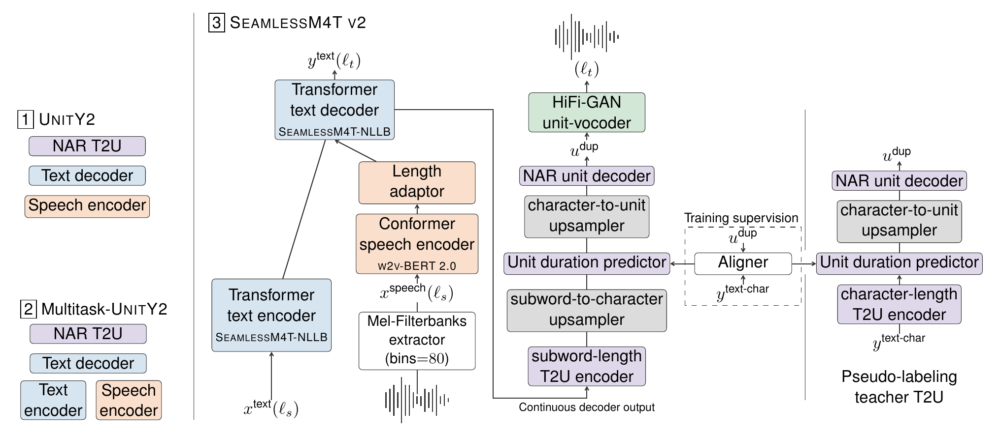
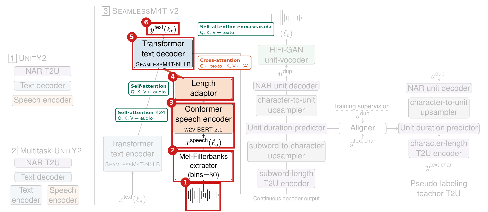
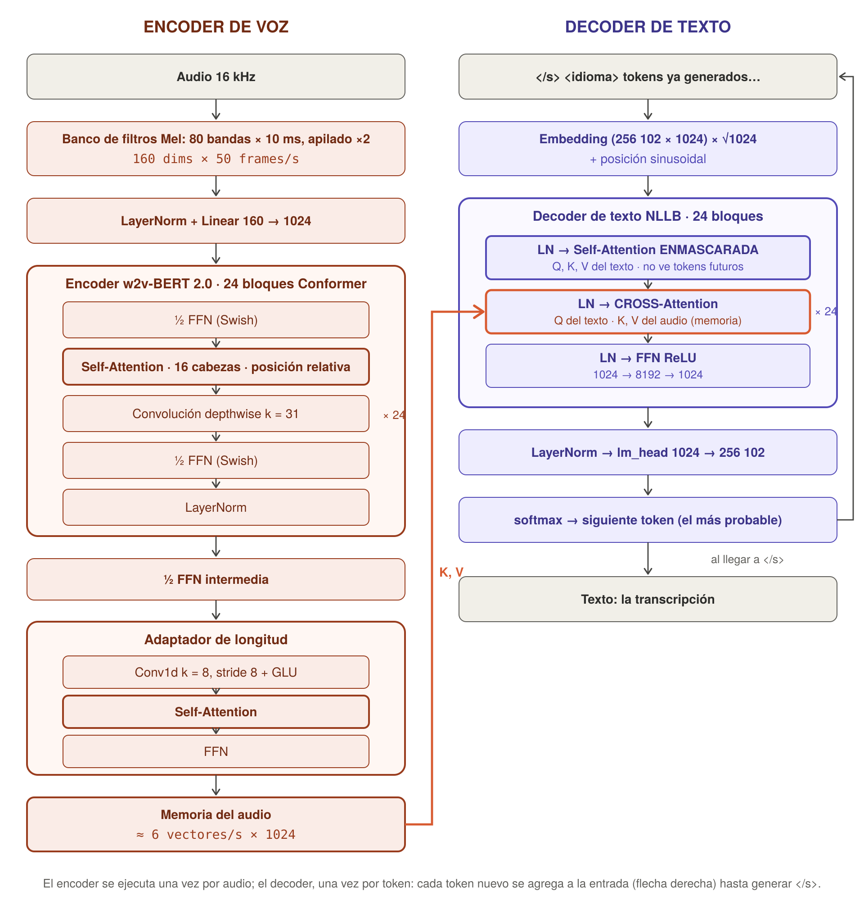
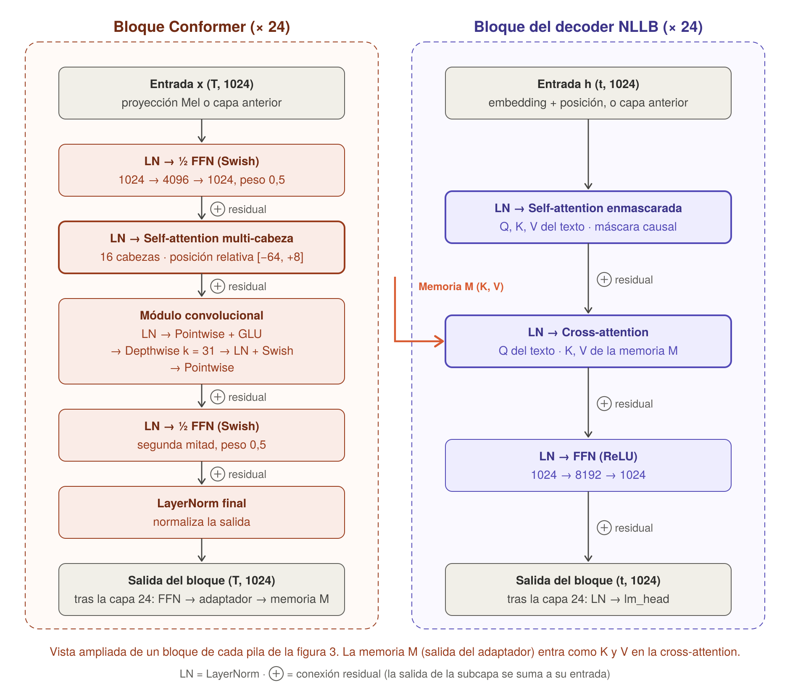
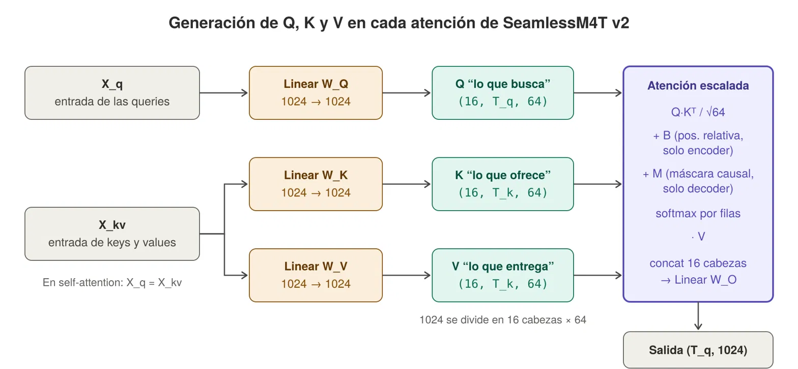
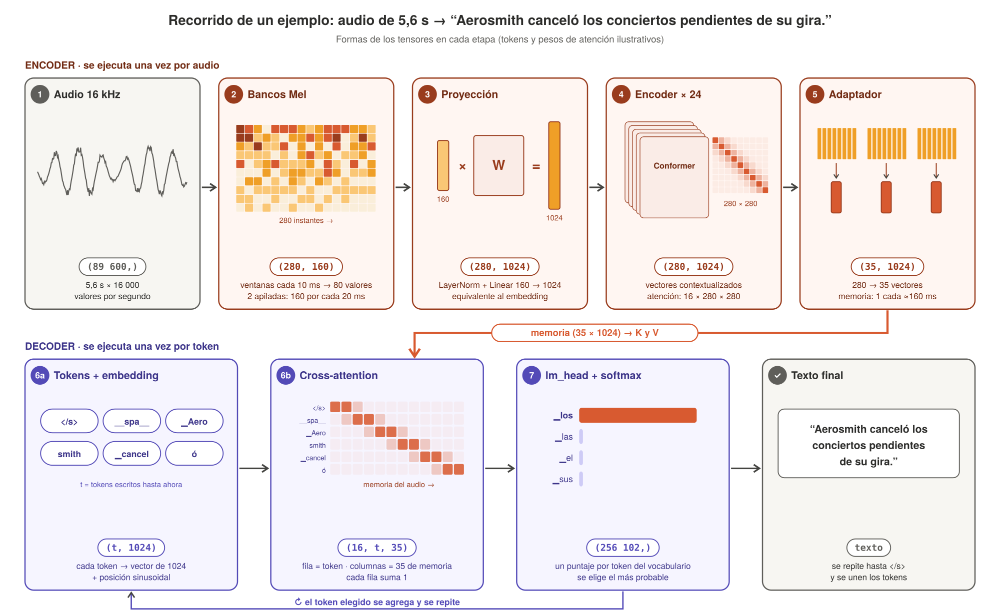
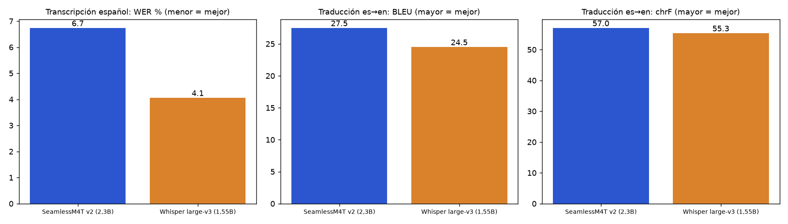
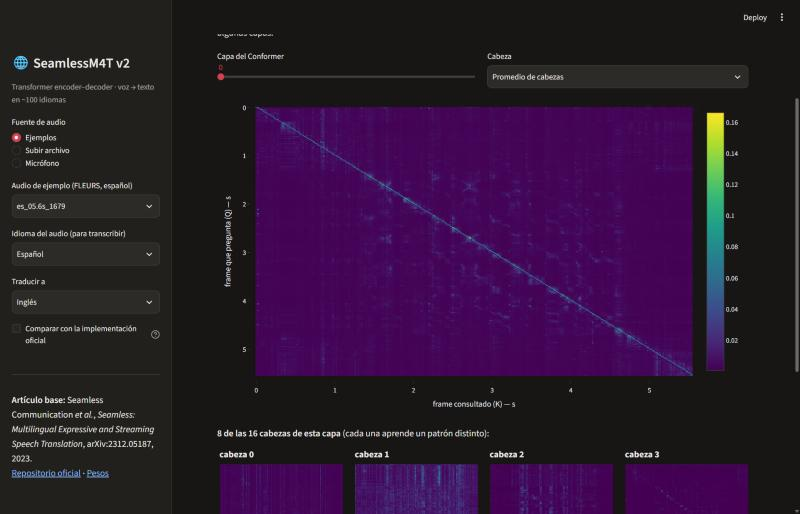

# SeamlessM4T v2 por dentro: transcripción de voz con un Transformer encoder–decoder

Proyecto final · Procesamiento de Datos Secuenciales 
**Integrantes:** Natalia Hernandez · Juan Ospina · Miguel Diuza · Yolima Alejandra Guadir

---

## 1. Resumen

Este trabajo aplica **SeamlessM4T v2** [1], Transformer encoder–decoder multilingüe de Meta, a la transcripción de voz. En esta implementación se usan los **pesos preentrenados oficiales** y se reimplementa la inferencia operación por operación: bancos de filtros Mel, 24 bloques Conformer, adaptador de longitud y 24 bloques de decoder, con Q, K, V, máscara y softmax explícitos. La implementación reproduce los logits del modelo oficial, con diferencias del orden de 10⁻⁶. Una aplicación en **Streamlit** permite visualizar la inferencia y los mapas de atención. En 150 frases de FLEURS en español, el modelo obtiene un WER de 6,74 % y un CER de 4,61 %, frente a 4,06 % y 2,47 % de Whisper large-v3.

**Palabras clave:** Transformer encoder–decoder, reconocimiento automático de voz, Conformer, atención multi-cabeza, cross-attention, SeamlessM4T.

---

## 2. Introducción

La implementación toma como referencia el artículo *“Seamless: Multilingual Expressive and Streaming Speech Translation”* (Seamless Communication, L. Barrault *et al.*, arXiv:2312.05187, diciembre de 2023) [1], que presenta la arquitectura SeamlessM4T v2. El código original se encuentra en el repositorio https://github.com/facebookresearch/seamless_communication, y los pesos preentrenados en [facebook/seamless-m4t-v2-large](https://huggingface.co/facebook/seamless-m4t-v2-large), distribuidos bajo licencia CC BY-NC 4.0 para uso académico.

El reconocimiento automático de voz transforma una señal de audio, larga y continua, en una secuencia corta y discreta de tokens de texto. Ambas secuencias difieren en longitud y carecen de una alineación conocida a priori, lo que hace adecuada una arquitectura encoder–decoder: el encoder construye una representación contextual del audio y el decoder genera el texto de forma autoregresiva, consultando mediante cross-attention la región del audio relevante en cada paso.

SeamlessM4T v2 es un modelo de fundación que resuelve con una sola red varias tareas de voz y texto en cerca de 100 idiomas. Para la transcripción integra dos componentes preentrenados a gran escala: un encoder de voz Conformer (w2v-BERT 2.0), entrenado de forma autosupervisada con 4,5 millones de horas de audio, y el decoder de texto del traductor NLLB [7]. Su análisis permite observar, en un modelo actual, cómo se aplican los mecanismos del Transformer (proyecciones Q, K y V, atención escalada, multi-cabeza, máscara causal y cross-attention) junto con componentes específicos del procesamiento de voz.

Aunque el modelo admite transcripción y traducción, este trabajo se realiza con el objetivo de describir detalladamente la arquitectura encoder–decoder de SeamlessM4T v2 aplicada a la tarea de transcripción. Para ello, se implementa su inferencia con los pesos preentrenados, se analiza la generación de los tensores Q, K y V en cada tipo de atención, se visualiza el proceso de forma interactiva y se evalúa su desempeño frente a Whisper large-v3 [2].

---

## 3. Marco teórico

### 3.1 SeamlessM4T v2 dentro de la familia Seamless

En el artículo de referencia [1] se presenta una familia de modelos para la comunicación multilingüe construida sobre un mismo modelo de fundación, SeamlessM4T v2. En la tabla 1 se describen de manera general las tareas que realiza cada uno:

| Modelo | Tareas que realiza |
|---|---|
| SeamlessM4T v1 [4] | Versión original del modelo de fundación; traduce voz y texto en cerca de 100 idiomas. |
| **SeamlessM4T v2** [1] | Versión mejorada; con una sola red realiza transcripción de voz, traducción de voz a texto, de texto a texto y de voz a voz. |
| SeamlessExpressive [1] | Traduce de voz a voz conservando el tono, la emoción y el estilo de quien habla. |
| SeamlessStreaming [1] | Traduce de forma simultánea, mientras la persona habla. |
| Seamless [1] | Une Expressive y Streaming para ofrecer traducción expresiva en tiempo real. |

*Tabla 1. Modelos de la familia Seamless y tareas que realizan. Elaborada a partir de [1] y [4].*

De esta familia, el presente trabajo utiliza SeamlessM4T v2 y describe su arquitectura únicamente para la tarea de transcripción, es decir, la conversión de una señal de voz en el texto correspondiente en el mismo idioma. Por ello, la descripción de la arquitectura, del mecanismo de atención y de la generación de los tensores Q, K y V se limita a los componentes que intervienen en esta tarea. La aplicación desarrollada en Streamlit también permite obtener la traducción de voz a texto, ya que el modelo usa la misma arquitectura y solo cambia el token de idioma del decoder; sin embargo, esta tarea no es objeto de análisis en el presente trabajo.

### 3.2 Conceptos clave

**Representación de la entrada.** El modelo opera con secuencias de vectores. El audio se representa con **bancos de filtros Mel**: la energía de cada ventana corta de la señal en 80 bandas de frecuencia, distribuidas según la escala Mel, que imita la percepción del oído. El texto se divide en **tokens** (subpalabras de un vocabulario fijo), y cada token se representa con un **embedding**, un vector aprendido. Como la atención no conoce el orden de los elementos, se añade una **codificación posicional**.

**Arquitectura encoder–decoder.** El **Transformer** [5] procesa secuencias con atención en lugar de recurrencia. El **encoder** transforma la entrada completa en una representación contextual, denominada en este trabajo **memoria**, y el **decoder** genera la salida token por token (**generación autoregresiva**) consultando esa memoria. El **Conformer** [6] es una variante del encoder para voz que combina atención, para el contexto global, y convolución, para los patrones locales.

**Atención.** Cada elemento se proyecta en una **query** (Q, lo que busca), una **key** (K, lo que ofrece) y un **value** (V, la información que entrega). La comparación de Q con K produce una **matriz de atención**, cuyas filas suman 1 y ponderan los values. En la **self-attention**, Q, K y V provienen de la misma secuencia; en la **cross-attention**, Q proviene del decoder y K y V de la memoria. La **atención multi-cabeza** repite la operación en paralelo, y la **máscara causal** impide que el decoder atienda tokens futuros. Los términos de apoyo se definen en el glosario (sección 9).

### 3.3 Arquitectura de referencia del artículo

La figura 1 reproduce la figura 3 del artículo base, con la arquitectura completa de SeamlessM4T v2.



*Figura 1. Arquitectura de SeamlessM4T v2. Tomada de la figura 3 de [1].*

El panel izquierdo es una leyenda de cómo se ensambla el modelo: (1) UnitY2 agrupa un encoder de voz, un decoder de texto y un generador de unidades de sonido (*NAR T2U*), y (2) Multitask-UnitY2 añade un encoder de texto para que la entrada también pueda ser texto. El panel central, (3) SeamlessM4T v2, muestra estos componentes en detalle.

Una parte de ellos procesa el audio para convertirlo en texto. El *Mel-Filterbanks extractor* transforma la forma de onda en vectores que describen la energía del sonido en distintas bandas de frecuencia. El *Conformer speech encoder* (w2v-BERT 2.0 [10]) toma esos vectores y extrae las características de la voz, considerando el contexto de toda la grabación. El *Length adaptor* acorta la secuencia resultante para acercarla a la longitud del texto. Por último, el *Transformer text decoder* consulta esa representación del audio y escribe el texto token por token, en el idioma que se le indique.

Los demás componentes atienden otras tareas del modelo. El *Transformer text encoder* procesa texto de entrada, cuando lo que se quiere es traducir un texto escrito. La columna de UnitY2 (*subword-length T2U encoder*, *subword-to-character upsampler*, *unit duration predictor*, *character-to-unit upsampler* y *NAR unit decoder*) convierte el texto generado en unidades de sonido, y el *HiFi-GAN unit-vocoder* [11] transforma esas unidades en voz, para la traducción de voz a voz. Finalmente, el *Aligner* y el modelo del panel derecho (*Pseudo-labeling teacher T2U*) solo se usaron durante el entrenamiento, para enseñar al modelo la duración de las unidades y generar datos de voz a voz.

### 3.4 Arquitectura implementada para la transcripción

El artículo trata la transcripción como una traducción en la que el idioma de origen y el de destino coinciden, ℓₜ = ℓₛ (sección 3.2.2 de [1]). Por eso solo se usa la ruta de voz a texto, resaltada en la figura 2: audio (1), extractor Mel (2), encoder Conformer (3), adaptador (4), decoder de texto (5) y texto de salida (6). Las etiquetas indican dónde ocurre la atención y de dónde salen Q, K y V.



*Figura 2. Componentes de SeamlessM4T v2 utilizados para la transcripción (1 a 6) y ubicación de las atenciones. La línea naranja entre el adaptador (4) y el decoder (5) es la cross-attention. Elaborada a partir de la figura 3 de [1].*

El artículo define estos bloques, pero no su estructura interna ni sus hiperparámetros. Estos se tomaron del Conformer [6], del decoder de NLLB [7] y de la configuración del modelo preentrenado `facebook/seamless-m4t-v2-large` publicada por los autores en la librería Transformers [8], [12], que es la que carga los pesos en este proyecto. La figura 3 presenta la arquitectura tal como quedó implementada, con sus valores concretos.



*Figura 3. Arquitectura implementada para la inferencia de la transcripción. Los bloques corresponden a la figura 3 de [1]; la estructura interna y los hiperparámetros provienen de [6], [7] y de la configuración del modelo preentrenado [12], verificados con la implementación del proyecto.*

La información recorre la arquitectura en el orden de la figura 3:

1. **Extracción de características.** El audio a 16 kHz se divide en ventanas de 25 ms tomadas cada 10 ms, y cada una se describe con su energía en 80 bandas Mel. Dos ventanas consecutivas se apilan en un vector de características acústicas de 160 valores (80 bandas × 2 ventanas), cuya dimensión es fija en el modelo (`feature_projection_input_dim`, sección 5.1) y no depende del audio. Se generan unos 50 de estos vectores por segundo, y una LayerNorm con una capa lineal los lleva a 1024 dimensiones, el tamaño interno de todo el modelo.
2. **Encoder de voz w2v-BERT 2.0.** Son 24 bloques Conformer, unos 600 M de parámetros preentrenados sin etiquetas con unos 4,5 M de horas de audio (sección 3.2.1 de [1]). Cada bloque enriquece los vectores con el contexto de la grabación sin cambiar su tamaño: combina self-attention de 16 cabezas, que relaciona fragmentos lejanos, con una convolución, que capta patrones locales como los fonemas.
3. **FFN intermedia y adaptador de longitud.** Una red feed-forward ajusta la salida del encoder, y el adaptador la comprime con una convolución de tamaño 8 y paso 8 seguida de self-attention y otra red feed-forward. Quedan unos 6 vectores por segundo: la **memoria** del audio, que el decoder consulta en cada paso.
4. **Decoder de texto NLLB.** Recibe `</s>`, el token del idioma y los tokens ya generados. Cada token se convierte en su embedding (tabla de 256 102 × 1024), se multiplica por √1024 y se le suma una posición sinusoidal. Luego pasa por 24 bloques con self-attention enmascarada, cross-attention sobre la memoria del audio y una red feed-forward.
5. **Salida.** Una LayerNorm y la capa `lm_head` (1024 → 256 102) dan un puntaje para cada token del vocabulario, y el softmax elige el más probable. Ese token vuelve a la entrada del decoder y el ciclo se repite hasta `</s>`. El encoder se ejecuta una vez por audio; el decoder, una vez por token.

La figura 4 amplía un bloque Conformer del encoder y un bloque del decoder, tal como se aplican en cada una de sus 24 capas.



*Figura 4. Estructura interna implementada de un bloque Conformer del encoder y de un bloque del decoder. Elaborada a partir de [1], [6], [12] y de la implementación del proyecto.*

En el bloque Conformer (izquierda), cada cuadro cumple una función:

- **Entrada x (T, 1024):** en la primera capa, los vectores de la proyección Mel; después, la salida del bloque anterior.
- **LN → ½ FFN (Swish):** normaliza el vector y lo pasa por una red feed-forward que lo amplía de 1024 a 4096 dimensiones y lo regresa a 1024. Su salida se multiplica por 0,5 antes de sumarse, es decir, se aplica solo la mitad del cambio que propone; junto con la segunda ½ FFN suman el aporte de una FFN completa, repartida antes y después de la atención y la convolución [6].
- **LN → Self-attention multi-cabeza:** cada fragmento de audio atiende a todos los demás, con 16 cabezas de 64 dimensiones. Usa posición relativa: distingue distancias de hasta 64 posiciones hacia atrás (≈ 1,28 s) y 8 hacia adelante (≈ 160 ms); las distancias mayores se truncan a esos límites.
- **Módulo convolucional:** convolución punto a punto con compuerta GLU, que decide qué parte de la señal pasa; convolución *depthwise* de tamaño 31, que filtra cada canal mirando a los fragmentos vecinos; LayerNorm con Swish; y otra convolución punto a punto.
- **LN → ½ FFN (Swish):** segunda mitad de la red feed-forward, también con peso 0,5.
- **LayerNorm final:** estabiliza la salida del bloque.
- **Salida del bloque (T, 1024):** pasa al bloque siguiente; tras el bloque 24 va a la FFN intermedia y al adaptador, que producen la memoria M.

En el bloque del decoder (derecha), cada cuadro cumple una función:

- **Entrada h:** al inicio, el embedding de los tokens con su posición; después, la salida del bloque anterior.
- **LN → Self-attention enmascarada:** cada token mira solo a los anteriores, con 16 cabezas.
- **LN → Cross-attention:** cada token consulta la memoria del audio (flecha naranja).
- **LN → FFN (ReLU):** amplía cada vector de 1024 a 8192 dimensiones y lo regresa a 1024.
- **Salida del bloque:** pasa al bloque siguiente; tras el bloque 24 va a LayerNorm y `lm_head`.

Entre cuadro y cuadro hay una **conexión residual** (⊕), que suma la entrada de cada subcapa a su salida para conservar la información original y facilitar el entrenamiento de un modelo tan profundo.

### 3.5 Entradas y salidas del modelo

La **entrada** es una señal de voz en cualquiera de los idiomas del modelo. A diferencia del texto, que se representa con embeddings, la voz es una señal continua y se describe con bancos de filtros Mel (sección 3.2). El decoder recibe además un token de inicio y el **token del idioma** en que debe escribir; para transcribir, es el mismo idioma del audio.

La **salida** es, en cada paso, una probabilidad para cada token del vocabulario de subpalabras. Se elige el más probable, se agrega a lo escrito y se repite hasta el token de fin; al unir los tokens se obtiene la transcripción. La sección 5.7 sigue este recorrido con un ejemplo concreto.

### 3.6 Mecanismo de atención

SeamlessM4T v2 implementa la atención descrita en la sección 3.2 como atención escalada por producto punto, igual que el Transformer [5]:

```
Atención(Q, K, V) = softmax( Q · Kᵀ / √d_k ) · V
```

El producto Q·Kᵀ mide la relación entre cada query y cada key, y la división por √d_k (√64 = 8) evita que los puntajes crezcan demasiado y saturen el softmax. El modelo usa 16 cabezas en paralelo.

En la transcripción, la atención aparece en cuatro lugares:

- **Self-attention del encoder:** cada fragmento de audio mira a todos los demás, con una **posición relativa** que indica qué tan lejos está un sonido de otro [9].
- **Self-attention del adaptador:** relaciona los fragmentos ya comprimidos.
- **Self-attention enmascarada del decoder:** cada token mira solo a los anteriores; una **máscara causal** bloquea los tokens futuros, que todavía no existen.
- **Cross-attention del decoder:** el texto “escucha” el audio, buscando en la memoria el fragmento que corresponde al siguiente token.

En la transcripción, como el texto sigue el orden del audio, los pesos de la cross-attention forman una diagonal (sección 6.3).

### 3.7 Generación de los tensores Q, K y V

El artículo no describe cómo se generan Q, K y V: los da por conocidos al indicar que el encoder es un Conformer [6] y el decoder, el de NLLB [7]. En su figura 3, la atención queda dentro de los cuadros del encoder, el adaptador y el decoder. Su generación se reconstruyó a partir de [5], [6] y de los pesos del modelo, donde cada capa contiene sus propias matrices de proyección.

En cada atención intervienen dos secuencias de entrada: X_q, de la que se obtienen las queries, y X_kv, de la que se obtienen las keys y los values. Ambas están formadas por vectores de 1024 valores, y cada una se multiplica por una matriz de pesos aprendida de 1024 × 1024, distinta en cada capa:

```
Q = X_q · W_Q        K = X_kv · W_K        V = X_kv · W_V
```

Q, K y V conservan la dimensión 1024 y se dividen en 16 cabezas de 64 valores. Así, Q tiene forma (16, T_q, 64) y K y V tienen forma (16, T_k, 64), donde T_q es el número de vectores de X_q y T_k el número de vectores de X_kv. Por cada cabeza, el producto Q·Kᵀ produce una matriz de T_q × T_k, con una fila por cada elemento que busca y una columna por cada elemento consultado. Tras el softmax, la multiplicación por V devuelve un vector por cada query; las 16 cabezas se concatenan y la matriz W_O las proyecta de nuevo a 1024, de modo que la salida tiene forma (T_q, 1024). La figura 5 resume este proceso.



*Figura 5. Generación de Q, K y V en una capa de atención. Elaborada a partir de [5], [6] y de la implementación del proyecto.*

La operación es la misma en las cuatro atenciones del camino de transcripción; lo que cambia es el origen de X_q y X_kv y, por tanto, el tamaño de la matriz de atención:

| Atención | X_q (queries) | X_kv (keys y values) | Matriz por cabeza |
|---|---|---|---|
| Self-attention del encoder | vectores de audio | los mismos vectores de audio | T × T |
| Self-attention del adaptador | vectores comprimidos | los mismos vectores comprimidos | T_mem × T_mem |
| Self-attention del decoder | tokens ya escritos | los mismos tokens | t × t |
| **Cross-attention** | **tokens ya escritos** | **memoria del audio** | **t × T_mem** |

T es el número de vectores de audio en el encoder, T_mem el número de vectores de la memoria tras el adaptador y t el número de tokens escritos hasta el paso actual. En el ejemplo de la sección 5.7, T = 280 y T_mem = 35.

En las self-attention, Q, K y V salen de la misma secuencia. En la cross-attention, Q sale del texto, porque el decoder es quien busca, y K y V salen del audio, porque es la entrada la que ofrece el contenido. En la self-attention del encoder se suma además la posición relativa a los puntajes, y en la del decoder, la máscara causal.

### 3.8 Innovaciones del modelo

1. **Un solo modelo para varias tareas y idiomas.** El mismo encoder y el mismo decoder resuelven transcripción y traducción en cerca de 100 idiomas; la tarea y el idioma de salida se eligen con un solo token.
2. **Encoder w2v-BERT 2.0 a gran escala.** Se preentrenó sin etiquetas con unos 4,5 M de horas de audio, 4,5 veces más que la versión 1, lo que mejora el desempeño en idiomas con pocos datos transcritos.
3. **Conformer con posición relativa.** Combina atención global y convolución local, y representa la posición como distancia entre fragmentos.
4. **Adaptador de longitud.** Comprime el audio 8 veces para acoplar un encoder de voz con un decoder de texto preentrenado por separado.
5. **Reutilización de NLLB.** El decoder proviene de un traductor de texto entrenado en unos 200 idiomas [7], de modo que el modelo hereda su conocimiento del lenguaje escrito.
6. **UnitY2** (fuera del alcance de este trabajo). Un T2U no autoregresivo con expansión jerárquica de subpalabras a caracteres y a unidades, que hace tres veces más rápida la traducción de voz a voz.

En el artículo, SeamlessM4T-Large v2 obtiene en FLEURS un WER promedio de 12,8 sobre 60 idiomas, frente a 17,2 de Whisper-Large-v3, y reduce el WER de la versión anterior en un 21 % relativo sobre 77 idiomas (tabla 7 de [1]).

### 3.9 Métricas de evaluación

La **tasa de error por palabra (WER)** es la métrica estándar de la transcripción y la que usa el artículo. Compara el texto del modelo con la transcripción correcta, contando las palabras sustituidas (*S*), eliminadas (*D*) e insertadas (*I*) respecto al número de palabras de la referencia (*N*):

```
WER = (S + D + I) / N
```

Antes de comparar, ambos textos se normalizan (minúsculas, sin puntuación). Menor es mejor: un WER de 5 % equivale, en promedio, a un error cada 20 palabras. La **tasa de error por carácter (CER)** hace el mismo cálculo con caracteres, así que es más fina: si el modelo escribe “concierto” en lugar de “conciertos”, el WER cuenta una palabra entera y el CER un solo carácter. El **factor de tiempo real (RTF)** divide el tiempo de inferencia entre la duración del audio; un valor menor que 1 significa que el modelo procesa el audio más rápido de lo que dura.


---

## 4. Metodología

- **Sin entrenamiento.** La función `from_pretrained` descarga los pesos (`model-0000X-of-00002.safetensors`) y la configuración (`config.json`) del repositorio oficial de Meta. Solo se instancia `SeamlessM4Tv2ForSpeechToText`, que contiene el encoder de voz y el decoder de texto.
- **Herramientas.** Python 3.11, PyTorch, `transformers` 4.57.6 [8], Streamlit, Plotly, `jiwer` (WER y CER) y Google Colab con GPU T4 para las métricas.
- **Implementación propia** (`src/seamless_paso_a_paso.py`). Reescribe con operaciones básicas de PyTorch todo el camino de voz a texto y guarda Q, K, V, puntajes y pesos de cada atención.
- **Validación** (`scripts/verificar_equivalencia.py`). Compara memoria, atenciones, logits y texto de la implementación propia con los de `transformers`.
- **Evaluación** (`scripts/evaluar.py`). Usa 150 frases del conjunto de prueba de FLEURS en español [3] y calcula, con las mismas frases y decodificación voraz, las métricas de transcripción de SeamlessM4T v2 y de Whisper large-v3 [2].

**Métricas.** La transcripción se evalúa con WER y CER, calculados con `jiwer` tras el normalizador básico de Whisper; y la velocidad, con el RTF. Las métricas se definen en la sección 3.9.

---

## 5. Desarrollo e implementación

### 5.1 Hiperparámetros

Los hiperparámetros son valores fijos de la arquitectura, definidos antes del entrenamiento e independientes de la entrada. Se toman del archivo [`config.json`](https://huggingface.co/facebook/seamless-m4t-v2-large/blob/main/config.json) del modelo preentrenado [12], que `from_pretrained` descarga junto con los pesos, y determinan las dimensiones de los bloques de las figuras 3 y 4. La tabla 2 recoge los principales; los valores internos de cada bloque (4096, 8192, kernel 31, posición relativa −64/+8) se indican en la figura 4.

| Parámetro (`config.json`) | Valor | Descripción |
|---|---|---|
| `feature_projection_input_dim` | 160 | Dimensión del vector de características de entrada (80 bandas Mel × 2 ventanas apiladas). |
| `hidden_size` | 1024 | Dimensión del modelo (d_model) en encoder y decoder. |
| `speech_encoder_layers` / `speech_encoder_attention_heads` | 24 / 16 | Bloques Conformer y cabezas de atención por bloque; d_k = 1024 / 16 = 64. |
| `adaptor_kernel_size` / `adaptor_stride` | 8 / 8 | Kernel y paso del adaptador; reduce la longitud de la secuencia en un factor de 8. |
| `decoder_layers` / `decoder_attention_heads` | 24 / 16 | Bloques del decoder y cabezas en la self-attention y la cross-attention. |
| `vocab_size` | 256 102 | Tamaño del vocabulario: filas de la tabla de embeddings y salidas de `lm_head`. |

*Tabla 2. Hiperparámetros principales del modelo preentrenado. Elaborada a partir de [12].*

### 5.2 Estructura del repositorio

```
seamless-traductor/
├── app.py                          # Aplicación Streamlit (visualización interactiva)
├── src/
│   ├── modelo.py                   # Carga de pesos, audio e inferencia oficial
│   └── seamless_paso_a_paso.py     # Inferencia reimplementada a mano (Q, K, V, máscara, softmax…)
├── scripts/
│   ├── preparar_datos.py           # FLEURS: ejemplos y conjunto de evaluación
│   ├── verificar_equivalencia.py   # Implementación propia == oficial
│   ├── evaluar.py                  # WER, CER y RTF frente a Whisper
│   └── crear_notebook_colab.py
├── notebooks/colab_seamless.ipynb  # Verificación, métricas en GPU y demo de respaldo
├── docs/arquitectura/              # Figuras de la arquitectura
├── docs/capturas/                  # Capturas de la aplicación
├── ejemplos/                       # Audios de prueba + referencias.csv
└── resultados/                     # metricas.csv y gráficas
```

### 5.3 Pasos para ejecutar

```bash
python -m venv .venv
.venv\Scripts\activate            # Linux/Mac: source .venv/bin/activate
pip install torch --index-url https://download.pytorch.org/whl/cpu
pip install -r requirements.txt
python scripts/preparar_datos.py  # descarga FLEURS y crea los ejemplos
streamlit run app.py              # http://localhost:8501
```

Se requieren unos 10 GB de disco para los pesos y unos 8 GB de RAM libres. Sin esos recursos, `notebooks/colab_seamless.ipynb` ejecuta todo en Colab y abre la aplicación con un enlace temporal.

### 5.4 Carga de los pesos preentrenados

```python
from transformers import AutoProcessor, SeamlessM4Tv2ForSpeechToText

procesador = AutoProcessor.from_pretrained("facebook/seamless-m4t-v2-large")
modelo = SeamlessM4Tv2ForSpeechToText.from_pretrained(
    "facebook/seamless-m4t-v2-large",
    attn_implementation="eager",   # atención explícita para poder leer sus pesos
).eval()
```

El procesador contiene el extractor de bancos de filtros Mel y el tokenizador SentencePiece. El modo `eager` calcula la atención con multiplicaciones y softmax explícitos, lo que permite extraer los pesos de cada cabeza.

### 5.5 Preprocesamiento

1. Lectura del audio (WAV, FLAC, MP3, OGG, M4A o micrófono), conversión a mono y remuestreo a 16 kHz.
2. Bancos de filtros Mel de 80 canales cada 10 ms, normalizados por canal.
3. Apilado de 2 ventanas consecutivas: `input_features` de forma (1, T, 160), con T ≈ 50 por segundo.

### 5.6 Inferencia

La arquitectura de las figuras 3 y 4 se implementó en `src/seamless_paso_a_paso.py` con operaciones básicas de PyTorch y los pesos oficiales, en tres funciones:

- **`codificar()`, del audio a la memoria:** aplica la proyección de características, los 24 bloques Conformer, la FFN intermedia y el adaptador de longitud, y devuelve la memoria del audio. Se ejecuta una sola vez por audio.
- **`decodificar()`, de los tokens a las probabilidades:** aplica el embedding escalado con la posición sinusoidal, los 24 bloques del decoder y la capa `lm_head`, y devuelve los logits del siguiente token.
- **`traducir()`, la generación:** inicia la secuencia con `</s>` y el token del idioma, llama a `codificar()` una vez y a `decodificar()` en cada paso, elige el token más probable (decodificación voraz) y lo agrega hasta que aparece `</s>`. Con el token del idioma del audio el resultado es la transcripción; con otro idioma, una traducción.

Las cuatro atenciones usan una misma función, `atencion()`. Esta aplica las proyecciones W_Q, W_K y W_V de cada capa, divide el resultado en 16 cabezas y calcula Q·Kᵀ/√64. Después suma la posición relativa (en el encoder) o la máscara causal (en el decoder), aplica el softmax, multiplica por V, concatena las cabezas y aplica la proyección de salida W_O. Además, guarda Q, K, V, los puntajes y los pesos de cada capa para visualizarlos en la aplicación.

La arquitectura se describe en la sección 3.4, y la sección 5.7 muestra las formas de los tensores en cada etapa con un audio de ejemplo.

### 5.7 Flujo de los datos en el encoder y el decoder: ejemplo con un audio de 5,6 s

Para ilustrar el flujo de los datos durante la inferencia se usa el audio de ejemplo `es_05.6s_1679.wav` de FLEURS, de 5,6 s, en el que se dice *“Aerosmith canceló los conciertos pendientes de su gira.”*. En cada paso se indica la forma del tensor resultante y el significado de cada número.

1. **Audio (89 600,).** El audio se muestrea a 16 kHz, es decir, 16 000 valores por segundo; los 5,6 s equivalen a unos 89 600 valores, cada uno la amplitud de la onda en un instante.
2. **Bancos de filtros Mel (280, 160).** La señal se analiza en ventanas de 25 ms tomadas cada 10 ms (unas 560) y cada ventana se resume en 80 valores, uno por banda Mel. Al apilar dos ventanas consecutivas, cada vector describe 20 ms de audio con 160 valores, que es la dimensión fija del vector de características acústicas. El 280 es la cantidad de vectores obtenidos: no es un hiperparámetro, sino la longitud de la secuencia, que depende de la duración del audio a razón de 50 vectores por segundo (5,6 × 50 = 280).
3. **Proyección (280, 1024).** LayerNorm y la capa lineal llevan cada uno de los 280 vectores de 160 a 1024 valores. El 1024 es la dimensión interna del modelo (`hidden_size`), la misma en el encoder y en el decoder. Este paso cumple el papel del embedding del texto, pero se calcula con una matriz en lugar de buscarse en una tabla, porque el audio es continuo y no tiene un vocabulario.
4. **Encoder (280, 1024).** Los 24 bloques Conformer mantienen la forma, pero cada vector pasa a ser una representación contextualizada, con información de toda la grabación. En la self-attention de cada capa, Q, K y V tienen forma (16, 280, 64): 16 cabezas de atención, 280 posiciones del audio y 64 valores por cabeza (16 × 64 = 1024). Cada cabeza produce una matriz de pesos de 280 × 280, en la que cada instante del audio se compara con todos los demás.
5. **Adaptador (35, 1024).** La secuencia se reduce de 280 a 35 vectores (280 / 8), uno cada 160 ms aproximadamente. El resultado es la memoria del audio, de la que se obtienen K y V para la cross-attention del decoder.
6. **Decoder (t, 1024).** La entrada comienza con `</s>` y `__spa__`, y t es la cantidad de tokens escritos hasta el paso actual, por lo que crece en uno en cada iteración. Cada token se convierte en un embedding de 1024. En la cross-attention, los pesos tienen forma (16, t, 35): para cada una de las 16 cabezas, cada uno de los t tokens se compara con los 35 vectores de la memoria, y su fila de 35 pesos suma 1 e indica en qué parte del audio se encuentra.
7. **Salida (256 102,).** En cada paso, `lm_head` produce 256 102 puntajes, uno por cada token del vocabulario del modelo. El softmax los convierte en probabilidades y se elige el token más probable. El ciclo se repite hasta generar `</s>` y los tokens se unen en el texto final.

La figura 6 resume este recorrido y la forma de los tensores en cada etapa.



*Figura 6. Recorrido del audio de ejemplo de 5,6 s por la arquitectura y forma de los tensores en cada etapa. Los tokens y los pesos de atención son ilustrativos.*

### 5.8 Aplicación interactiva

La aplicación de Streamlit permite elegir el audio de tres fuentes (ejemplos de FLEURS, archivo propio o micrófono) y el idioma del audio. Muestra la transcripción y, opcionalmente, la traducción, en siete pestañas: resultado, cross-attention, Q·K·V paso a paso, encoder Conformer, decoder con máscara, arquitectura y dimensiones, y métricas. También puede comparar el resultado con la implementación oficial.

---

## 6. Resultados y análisis

### 6.1 Validación de la implementación propia

`scripts/verificar_equivalencia.py` se ejecutó sobre `es_05.6s_1679.wav` (5,6 s), comparando la inferencia manual con la oficial:

| | Transcripción (`spa`) |
|---|---|
| Diferencia máxima en la memoria del encoder | 3,8·10⁻⁶ |
| Diferencia máxima en la atención del encoder | 0 |
| Diferencia máxima en la cross-attention | 1,7·10⁻⁶ |
| Diferencia máxima en los logits | 4,8·10⁻⁶ |
| Texto | «Aerosmith canceló los conciertos pendientes de su gira.» (idéntico) |

Las diferencias corresponden a redondeo de punto flotante. Las 48 capas reescritas a mano (24 Conformer y 24 de decoder), la posición relativa, el adaptador, la máscara y el softmax coinciden con el modelo original.

### 6.2 Desempeño en transcripción

Se evaluaron 150 frases aleatorias del conjunto de prueba de FLEURS en español (30 min de habla, 12,2 s en promedio), en GPU T4, precisión fp16, decodificación voraz y las mismas frases para ambos modelos.

| Modelo | Parámetros | WER ↓ | CER ↓ | RTF ↓ | Latencia media |
|---|---|---|---|---|---|
| SeamlessM4T v2 | 2,3 B (modelo completo) | 6,74 % | 4,61 % | 0,156 | 1,91 s |
| Whisper large-v3 | 1,55 B | **4,06 %** | **2,47 %** | **0,125** | **1,52 s** |



**Análisis.**

- **Whisper large-v3 transcribe mejor el español:** 4,1 % frente a 6,7 % de WER, y transcribe perfectamente 90 frases frente a 73 de SeamlessM4T v2. El resultado contrasta con el artículo, donde SeamlessM4T v2 supera a Whisper-Large-v3 en promedio (12,8 frente a 17,2 de WER en 60 idiomas de FLEURS). La diferencia se explica porque el artículo promedia muchos idiomas, incluidos varios con pocos recursos, donde SeamlessM4T v2 es más fuerte; el español, en cambio, es un idioma con abundantes datos en el entrenamiento de Whisper.
- **El CER es menor que el WER en ambos modelos.** Muchos errores afectan pocas letras de una palabra (por ejemplo, una terminación), por lo que cuentan como palabra completa en el WER pero solo como uno o dos caracteres en el CER.
- **Velocidad:** con una GPU T4 ambos modelos procesan el audio unas 6 a 8 veces más rápido que su duración (RTF entre 0,12 y 0,16). Whisper es algo más rápido.
- **Cifras y nombres propios:** si el modelo escribe una cifra o un nombre en un formato distinto al de la referencia (por ejemplo, con palabras en lugar de dígitos), el normalizador no los iguala y el WER aumenta aunque el texto sea correcto al oído.

### 6.3 Capturas de la aplicación

Capturas propias de la aplicación ejecutándose en local (CPU) con el audio de ejemplo `es_05.6s_1679` de FLEURS. La aplicación también muestra la traducción de voz a texto, que no se analiza en este trabajo.

**Resultado.** Entrada de audio y transcripción, con la forma de onda y los bancos de filtros Mel. La inferencia propia tarda unos 40 s en CPU.


**Cross-attention audio↔texto (capa 12 del decoder, promedio de cabezas).** En la transcripción aparece una diagonal: cada token atiende al fragmento de audio donde se pronunció, en el mismo orden.


**Q, K y V paso a paso.** Forma y origen de cada tensor en la cross-attention, con QKᵀ/√d_k, el softmax y el producto por V.


**Self-attention del encoder Conformer (capa 0).** Atención vector contra vector, concentrada cerca de la diagonal: en las primeras capas cada sonido atiende sobre todo a sus vecinos.



**Self-attention enmascarada del decoder.** Los pesos forman un triángulo inferior: la máscara causal impide mirar tokens futuros.


---

## 7. Conclusiones

**Aprendizajes**

- La transcripción con SeamlessM4T v2 requiere solo un subconjunto de la arquitectura del artículo: el extractor de bancos de filtros Mel, el encoder Conformer w2v-BERT 2.0, el adaptador de longitud y el decoder de texto. El text encoder, UnitY2, el vocoder y el teacher T2U no intervienen en esta tarea.
- El modelo combina los bloques del Transformer (Q, K, V, atención escalada, multi-cabeza, máscara causal y cross-attention) con componentes propios del habla: el Conformer, que une atención global y convolución local; la posición relativa, que representa la distancia entre fragmentos de audio; y el adaptador, que acerca la longitud del audio a la del texto.
- La cross-attention es el punto en el que el texto se alinea con el audio: Q proviene de los tokens generados y K y V de la memoria del audio. En la transcripción, sus pesos forman una diagonal, porque el texto sigue el mismo orden de la voz.
- El artículo no describe la generación de Q, K y V ni la estructura interna de los bloques. Reconstruirlas a partir de la configuración del modelo y reimplementar las 48 capas permitió verificar cada tensor, con resultados equivalentes a los del modelo oficial (diferencias del orden de 10⁻⁶).
- En el caso evaluado, español en FLEURS, SeamlessM4T v2 obtiene un WER de 6,74 % y un CER de 4,61 %, mientras que Whisper large-v3 transcribe con menos error (4,06 % y 2,47 %). Este resultado contrasta con el promedio de 60 idiomas reportado en el artículo, donde SeamlessM4T v2 supera a Whisper large-v3. El desempeño en transcripción depende, por tanto, del idioma: la ventaja de SeamlessM4T v2 se concentra en idiomas con menos datos de entrenamiento.

**Limitaciones**

- Tamaño: la ruta de voz a texto tiene unos 1,5 mil millones de parámetros (unos 6 GB en RAM y 9 GB de descarga); en CPU, la transcripción de una frase tarda unos 40 s.
- La implementación manual no usa caché de K/V ni búsqueda en haz (*beam search*): está pensada para inspeccionar la inferencia, no para la velocidad.
- Las cifras y algunos nombres propios pueden transcribirse en un formato distinto al de la referencia, lo que aumenta el WER aunque el contenido sea correcto.
- La evaluación abarca 150 frases de un solo idioma, leídas en condiciones controladas.
- La licencia CC BY-NC 4.0 de los pesos solo permite uso no comercial.

**Posibles mejoras**

- Incorporar búsqueda en haz y caché de K/V en la implementación propia para reducir el tiempo de transcripción.
- Normalizar cifras y formatos antes de calcular el WER.
- Evaluar la transcripción en más idiomas, especialmente de pocos recursos, y en audio ruidoso o de habla espontánea.
- Probar la cuantización (int8) para ejecutar el modelo en equipos con menos memoria.

---

## 8. Referencias

[1] Seamless Communication, L. Barrault *et al.*, “Seamless: Multilingual expressive and streaming speech translation,” *arXiv preprint* arXiv:2312.05187, 2023.

[2] A. Radford, J. W. Kim, T. Xu, G. Brockman, C. McLeavey, and I. Sutskever, “Robust speech recognition via large-scale weak supervision,” in *Proc. 40th Int. Conf. Machine Learning (ICML)*, 2023, pp. 28492–28518.

[3] A. Conneau *et al.*, “FLEURS: Few-shot learning evaluation of universal representations of speech,” in *Proc. IEEE Spoken Language Technology Workshop (SLT)*, 2023, pp. 798–805.

[4] Seamless Communication, L. Barrault *et al.*, “SeamlessM4T: Massively multilingual & multimodal machine translation,” *arXiv preprint* arXiv:2308.11596, 2023.

[5] A. Vaswani *et al.*, “Attention is all you need,” in *Advances in Neural Information Processing Systems (NeurIPS)*, vol. 30, 2017, pp. 5998–6008.

[6] A. Gulati *et al.*, “Conformer: Convolution-augmented transformer for speech recognition,” in *Proc. Interspeech*, 2020, pp. 5036–5040.

[7] NLLB Team, “Scaling neural machine translation to 200 languages,” *Nature*, vol. 630, pp. 841–846, 2024.

[8] T. Wolf *et al.*, “Transformers: State-of-the-art natural language processing,” in *Proc. Conf. Empirical Methods in Natural Language Processing: System Demonstrations (EMNLP)*, 2020, pp. 38–45.

[9] P. Shaw, J. Uszkoreit, and A. Vaswani, “Self-attention with relative position representations,” in *Proc. Conf. North American Chapter of the Association for Computational Linguistics (NAACL-HLT)*, 2018, pp. 464–468.

[10] Y.-A. Chung *et al.*, “w2v-BERT: Combining contrastive learning and masked language modeling for self-supervised speech pre-training,” in *Proc. IEEE Automatic Speech Recognition and Understanding Workshop (ASRU)*, 2021, pp. 244–250.

[11] J. Kong, J. Kim, and J. Bae, “HiFi-GAN: Generative adversarial networks for efficient and high fidelity speech synthesis,” in *Advances in Neural Information Processing Systems (NeurIPS)*, vol. 33, 2020, pp. 17022–17033.

[12] Hugging Face, “SeamlessM4T-v2,” *Transformers documentation*, 2023. [Online]. Available: https://huggingface.co/docs/transformers/model_doc/seamless_m4t_v2

---
## 9. Glosario

- **Autosupervisado:** entrenamiento sin etiquetas, en el que el modelo aprende a partir de los propios datos.
- **Beam search (búsqueda en haz):** estrategia de generación que explora varias secuencias candidatas a la vez; no se usa en este trabajo.
- **Caché de K/V:** técnica que guarda K y V de pasos anteriores para no recalcularlos en cada token.
- **Capa lineal:** operación que multiplica un vector por una matriz de pesos y suma un sesgo.
- **Convolución depthwise:** convolución que filtra cada canal por separado a lo largo del tiempo.
- **d_model:** dimensión de los vectores internos del modelo (1024).
- **FFN (red feed-forward):** dos capas lineales con una función de activación entre ellas, aplicadas a cada vector por separado.
- **Función de activación:** operación no lineal aplicada dentro de la red; aquí, ReLU y Swish.
- **GLU:** compuerta que usa una mitad del vector para regular cuánto pasa de la otra.
- **Greedy (decodificación voraz):** elegir en cada paso el token más probable.
- **LayerNorm:** normalización de cada vector a media 0 y varianza 1, seguida de una escala y un desplazamiento aprendidos.
- **lm_head y logits:** capa lineal final que asigna un puntaje (logit) a cada token del vocabulario, antes del softmax.
- **SentencePiece:** tokenizador que divide el texto en subpalabras.
- **Softmax:** función que convierte puntajes en probabilidades que suman 1.
- **Token de idioma:** token (como `__spa__`) que indica al decoder en qué idioma escribir.