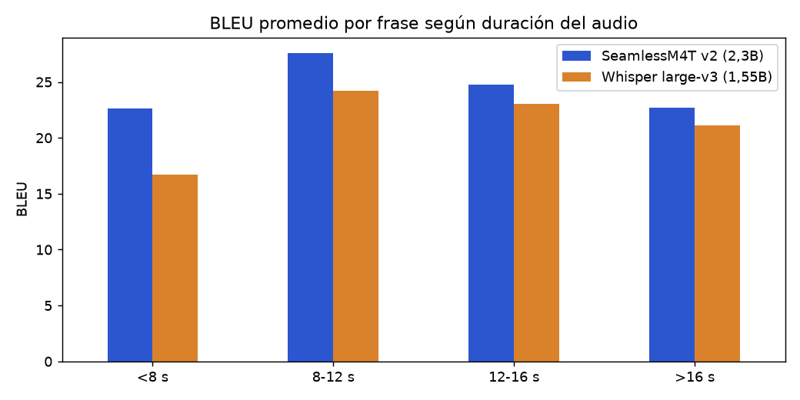
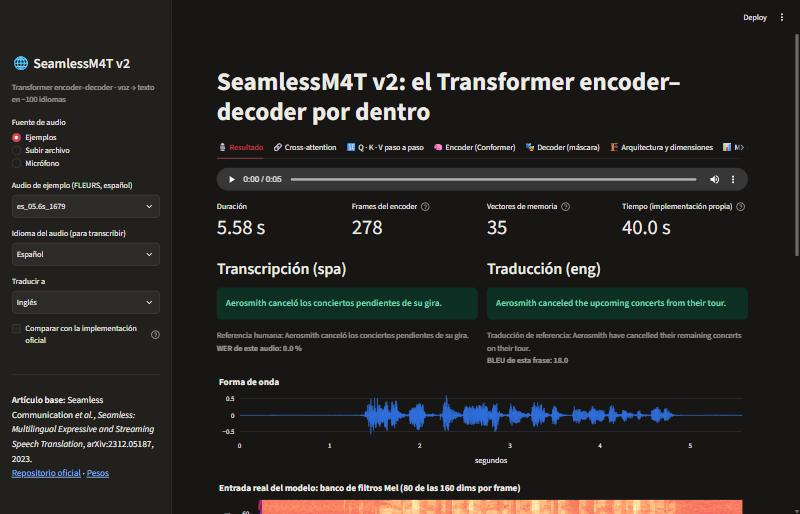
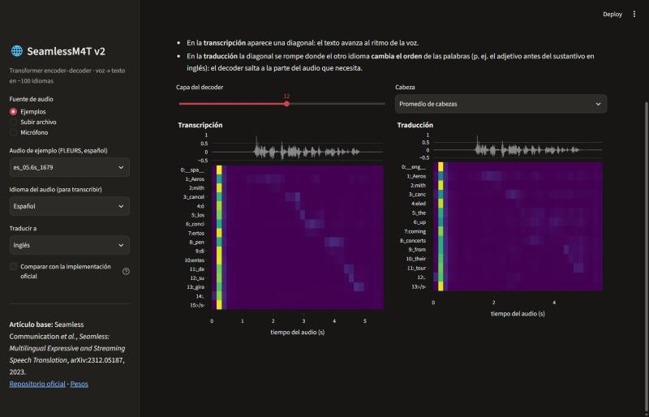
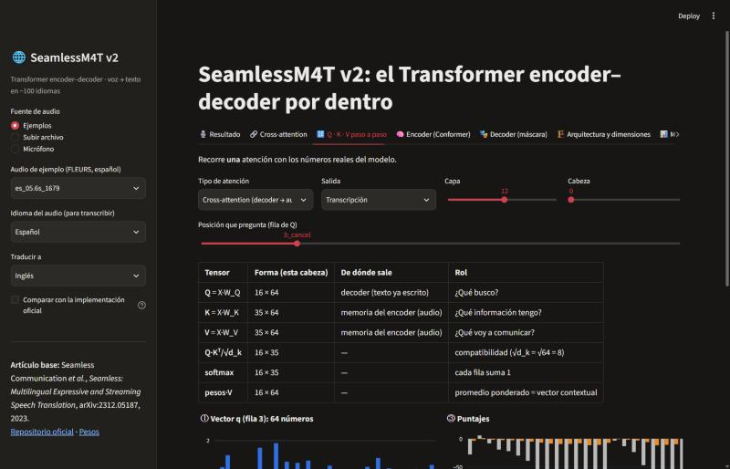
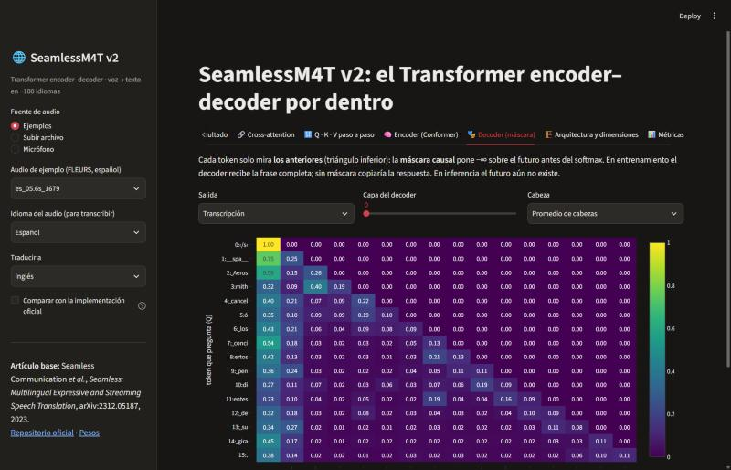

# SeamlessM4T v2 por dentro: traducción de voz con un Transformer encoder–decoder

Proyecto final · Procesamiento de Datos Secuenciales · 2026

**Integrantes:** Natalia Hernandez · Juan Ospina · Miguel Diuza · Yolima Alejandra Guadir

---

## 1. Resumen

Aplicamos **SeamlessM4T v2** [1], el Transformer encoder–decoder multilingüe de Meta (2023), a la traducción de voz: una persona habla en español y el modelo devuelve el texto transcrito en español o traducido a otro idioma. Usamos los **pesos preentrenados oficiales** y reescribimos la inferencia completa **operación por operación** (banco de filtros, 24 bloques Conformer con atención de posición relativa, adaptador de longitud y 24 bloques de decoder con self-attention enmascarada y cross-attention), con Q, K, V, Q·Kᵀ/√d_k, máscara y softmax explícitos. Comprobamos que nuestra versión produce los mismos logits y el mismo texto que la implementación oficial. Una aplicación en **Streamlit** permite cargar o grabar audio y ver la inferencia por dentro: generación token a token, mapas de cross-attention audio↔texto (diagonal en la transcripción, saltos donde la traducción reordena palabras) y el recorrido de los tensores.

En 150 frases de FLEURS, SeamlessM4T v2 traduce de español a inglés con **27,5 BLEU** frente a 24,5 de Whisper large-v3, mientras que Whisper transcribe mejor el español (WER 4,1 % frente a 6,7 %).

## 2. Introducción

**Artículo base:** Seamless Communication, L. Barrault *et al.*, “Seamless: Multilingual Expressive and Streaming Speech Translation,” arXiv:2312.05187, dic. 2023.
**Repositorio original:** https://github.com/facebookresearch/seamless_communication · **Pesos:** [facebook/seamless-m4t-v2-large](https://huggingface.co/facebook/seamless-m4t-v2-large) (CC BY-NC 4.0, uso académico)

**Contexto.** Para que dos personas sin idioma común se comuniquen por voz, lo habitual es encadenar dos sistemas: reconocimiento de voz (ASR) y luego traducción automática (MT). Los errores del primero se propagan al segundo, y cada uno se entrena por separado.

**Motivación.** SeamlessM4T v2 hace la traducción de voz **de extremo a extremo** con un solo modelo encoder–decoder: el encoder entiende el audio (100 idiomas de entrada) y el decoder escribe directamente en el idioma pedido (96 idiomas de salida). El mismo modelo transcribe o traduce según un único token de idioma.

**Objetivo.** Implementar y explicar la inferencia de SeamlessM4T v2 con sus pesos preentrenados, analizar cómo se generan Q, K y V en cada tipo de atención, visualizarlo de forma interactiva y medir su desempeño en español frente a Whisper.

## 3. Marco teórico

### 3.1 Arquitectura (modelo X2T, sección 3.2.2 y figura 3 del artículo)

```
audio 16 kHz ─► banco de filtros Mel 80 × 10 ms, apilado ×2 ─► 160 dims × 50 frames/s
   ─► LayerNorm + Linear 160→1024
   ─► ENCODER DE VOZ w2v-BERT 2.0 × 24 bloques Conformer:
        ½FFN(swish) → Self-Attention (16 cabezas, posición relativa) → Conv (depthwise k=31) → ½FFN → LN
   ─► ½FFN intermedia ─► ADAPTADOR DE LONGITUD (Conv1d k=8, stride 8 + GLU + Self-Attention + FFN)
   ─► memoria ≈ 6 vectores/s × 1024 ───────────────────────────────────── K, V ──┐
                                                                                 ▼
</s> <idioma> tokens… ─► Embedding (256 102 × 1024) × √1024 + posición sinusoidal
   ─► DECODER DE TEXTO (NLLB) × 24 bloques:
        LN → Self-Attention ENMASCARADA → LN → CROSS-Attention (Q texto; K,V audio) → LN → FFN ReLU 8192
   ─► LayerNorm ─► lm_head 1024→256 102 ─► softmax ─► siguiente token
```

| Componente | Detalle |
|---|---|
| Encoder de voz | w2v-BERT 2.0: 24 capas Conformer, D = 1024, 16 cabezas (d_k = 64), FFN 4096, ≈ 600 M parámetros, preentrenado de forma auto-supervisada con 4,5 M horas |
| Adaptador | reduce la longitud 8× (de 50 a ≈ 6 vectores por segundo) |
| Decoder de texto | decoder de NLLB: 24 capas, D = 1024, 16 cabezas, FFN 8192, vocabulario 256 102 |
| Idiomas | 100 de entrada (voz), 96 de salida (texto) |

### 3.2 Mecanismo de atención

**Attention(Q, K, V) = softmax(Q·Kᵀ/√d_k + B + M)·V**

1. **Q = X·W_Q, K = X·W_K, V = X·W_V**: cada posición cumple tres roles, *qué busco*, *qué información tengo* y *qué comunico*. Las tres matrices son aprendidas.
2. **Q·Kᵀ** mide por producto punto la compatibilidad entre cada consulta y cada clave.
3. **÷√d_k** (= 8) evita que los puntajes crezcan con la dimensión y saturen el softmax.
4. **B (solo encoder)**: término de **posición relativa** q·r₍ⱼ₋ᵢ₎, con un vector aprendido por cada distancia entre frames (de −64 a +8).
5. **M (solo self-attention del decoder)**: −∞ sobre posiciones futuras; tras el softmax su peso es 0.
6. **softmax** por filas: pesos ∈ [0, 1] que suman 1. **·V**: promedio ponderado del contenido.

**Multi-Head:** 16 cabezas de 64 dimensiones con proyecciones propias; se concatenan y se mezclan con W_O.

| Atención | Q | K y V | Máscara | Posición |
|---|---|---|---|---|
| Self-attention del encoder (×24) | frames de audio | frames de audio | no | relativa (en la atención) |
| Self-attention del adaptador | frames reducidos | frames reducidos | no | — |
| Self-attention del decoder (×24) | tokens ya escritos | tokens ya escritos | causal | sinusoidal (en el embedding) |
| Cross-attention (×24) | decoder (texto) | memoria del encoder (audio) | no | — |

### 3.3 Innovaciones

1. **Traducción de voz de extremo a extremo y masivamente multilingüe** en un solo modelo X2T, que en el artículo supera en BLEU a los sistemas en cascada y a Whisper-Large-v2 (26,6 vs 17,9 en FLEURS X→eng).
2. **w2v-BERT 2.0**: encoder Conformer preentrenado sin etiquetas con 4,5 M horas de audio (v1 usaba 1 M).
3. **Conformer**: combina self-attention (contexto global) y convolución (patrones locales del habla) con FFN tipo *macaron* y **posición relativa**.
4. **Adaptador de longitud**: comprime la memoria del audio 8× para acercarla a la longitud del texto y abaratar la cross-attention.
5. **UnitY2** (fuera de nuestro alcance voz→texto): decoder no autoregresivo de unidades de voz para generar habla traducida.
6. Un **token de idioma** selecciona la tarea: el mismo decoder transcribe (idioma del audio) o traduce (otro idioma).

## 4. Metodología

- **Sin entrenamiento:** `from_pretrained` descarga `model-0000X-of-00002.safetensors` y `config.json` del repositorio de Meta. Solo instanciamos `SeamlessM4Tv2ForSpeechToText` (encoder de voz + decoder de texto).
- **Herramientas:** Python 3.11, PyTorch, `transformers` 4.57.6, Streamlit, Plotly, `jiwer` (WER/CER), `sacrebleu` (BLEU/chrF), Google Colab (GPU T4) para las métricas.
- **Implementación propia** (`src/seamless_paso_a_paso.py`): reescribe con operaciones básicas de PyTorch todo el camino voz→texto y guarda Q, K, V, puntajes y pesos de cada atención.
- **Validación** (`scripts/verificar_equivalencia.py`): compara memoria, atenciones, logits y texto contra `transformers`.
- **Evaluación** (`scripts/evaluar.py`): 150 frases de FLEURS español (test) [3]; transcripción (WER, CER) y traducción al inglés (BLEU, chrF); comparación con Whisper large-v3 [2] en las mismas condiciones (greedy, mismas frases).

## 5. Desarrollo e implementación

### Estructura

```
seamless-traductor/
├── app.py                          # App Streamlit (visualización interactiva)
├── src/
│   ├── modelo.py                   # Carga de pesos, audio, inferencia oficial
│   └── seamless_paso_a_paso.py     # Inferencia reimplementada a mano (Q, K, V, máscara, softmax…)
├── scripts/
│   ├── preparar_datos.py           # FLEURS es→en: ejemplos y conjunto de evaluación
│   ├── verificar_equivalencia.py   # Implementación propia == oficial
│   ├── evaluar.py                  # WER, CER, BLEU, chrF, RTF vs Whisper
│   └── crear_notebook_colab.py
├── notebooks/colab_seamless.ipynb  # Verificación + métricas en GPU + demo de respaldo
├── ejemplos/                       # Audios de prueba + referencias.csv
└── resultados/                     # metricas.csv y gráficas
```

### Pasos para ejecutar

```bash
python -m venv .venv
.venv\Scripts\activate            # Linux/Mac: source .venv/bin/activate
pip install torch --index-url https://download.pytorch.org/whl/cpu
pip install -r requirements.txt
python scripts/preparar_datos.py  # descarga FLEURS y crea los ejemplos
streamlit run app.py              # http://localhost:8501
```

Requisitos: ≈ 10 GB de disco para los pesos y ≈ 8 GB de RAM libres. Sin esos recursos, `notebooks/colab_seamless.ipynb` corre todo en Colab y abre la app con un enlace temporal.

### Carga de pesos

```python
from transformers import AutoProcessor, SeamlessM4Tv2ForSpeechToText
procesador = AutoProcessor.from_pretrained("facebook/seamless-m4t-v2-large")
modelo = SeamlessM4Tv2ForSpeechToText.from_pretrained("facebook/seamless-m4t-v2-large",
                                                      attn_implementation="eager").eval()
```

### Preprocesamiento

1. Lectura del audio (WAV, FLAC, MP3, OGG o micrófono), conversión a mono y remuestreo a 16 kHz.
2. Banco de filtros Mel de 80 canales cada 10 ms, normalizado por canal.
3. Apilado de 2 frames consecutivos → `input_features` de forma (1, T, 160), con T ≈ 50 por segundo.

### Inferencia

1. **Encoder (una vez):** proyección → 24 Conformer → ½FFN → adaptador → memoria (≈ 6 vectores/s × 1024).
2. **Decoder (una vez por token):** entrada `</s>` + `__spa__` (transcribir) o `__eng__` (traducir); self-attention enmascarada → cross-attention sobre la memoria → FFN → logits (256 102) → softmax → token más probable (greedy) → se agrega a la entrada.
3. Termina con `</s>`; los tokens SentencePiece se decodifican a texto.

## 6. Resultados y análisis

### 6.1 Validación de la implementación propia

`scripts/verificar_equivalencia.py` sobre `es_05.6s_1679.wav` (5,6 s), comparando nuestra inferencia manual con la oficial:

| | Transcripción (`spa`) | Traducción (`eng`) |
|---|---|---|
| máx. diferencia en la memoria del encoder | 3,8·10⁻⁶ | 3,8·10⁻⁶ |
| máx. diferencia en la atención del encoder | 0 | 0 |
| máx. diferencia en la cross-attention | 1,7·10⁻⁶ | 1,2·10⁻⁶ |
| máx. diferencia en los logits | 4,8·10⁻⁶ | 3,0·10⁻⁶ |
| texto | «Aerosmith canceló los conciertos pendientes de su gira.» (idéntico) | «Aerosmith canceled the upcoming concerts from their tour.» (idéntico) |

Las diferencias son de redondeo de punto flotante: las 48 capas reescritas a mano (24 Conformer + 24 de decoder), la posición relativa, el adaptador, la máscara y el softmax coinciden con el modelo original.

### 6.2 Métricas de desempeño

150 frases aleatorias de FLEURS español (test), 30 min de habla, 12,2 s en promedio. GPU T4 en Colab, precisión fp16, decodificación greedy y las mismas frases para los dos modelos. WER/CER con el normalizador básico de Whisper; BLEU y chrF con `sacrebleu`.

| Modelo | Transcripción español: WER ↓ | CER ↓ | Traducción es→en: BLEU ↑ | chrF ↑ | RTF (transcribir / traducir) |
|---|---|---|---|---|---|
| **SeamlessM4T v2** | 6,74 % | 4,61 % | **27,5** | **57,0** | 0,156 / 0,149 |
| Whisper large-v3 | **4,06 %** | **2,47 %** | 24,5 | 55,3 | 0,125 / 0,095 |




**Análisis**

- **En traducción, SeamlessM4T v2 supera a Whisper large-v3** por 3 puntos BLEU y 1,7 de chrF. Es mejor en 84 de las 150 frases (Whisper en 59, 7 empates) y gana en **todos** los rangos de duración, con la mayor ventaja en frases cortas (< 8 s: 22,6 vs 16,7). Esto coincide con el artículo, que reporta 26,6 BLEU promedio en FLEURS X→inglés.
- **En transcripción del español, Whisper large-v3 es mejor** (4,1 % vs 6,7 % de WER; transcribe perfecto 90 frases contra 73). Whisper large-v3 (nov. 2023) fue entrenado con muchísimo audio en idiomas de muchos recursos como el español, y el artículo de Seamless compara contra la versión anterior, large-v2. Ningún modelo gana en todo: Seamless está optimizado para traducir.
- **Velocidad:** con una GPU T4 los dos transcriben unas 6–10 veces más rápido que el tiempo real (RTF 0,10–0,16). Whisper es algo más rápido.
- **Errores típicos observados:**
  - *Nombres propios:* el luchador “Luna” → Whisper tradujo *“The Moon's fellow fighters”*; Seamless conservó *“Luna's fellow wrestlers”*.
  - *Números y formatos:* “802.11a” → Seamless escribió *“eight hundred and eleven a”*, correcto al oído pero penalizado por BLEU; Whisper conservó el formato.
  - *Ambigüedad del español:* “**su** defensa disciplinada” (de *ellos*) → ambos tradujeron *“His”* en vez de *“Their”*: el posesivo “su” no indica el número.
- **Visualizaciones:** en la transcripción la cross-attention forma una diagonal audio↔texto; en la traducción la diagonal se rompe donde el inglés reordena palabras, y el decoder salta a la parte del audio que necesita.

### 6.3 Capturas de la aplicación

Capturas propias de la aplicación ejecutándose en local (CPU) con el audio de ejemplo `es_05.6s_1679` de FLEURS.

**Resultado:** entrada (audio), transcripción en español y traducción al inglés, con la forma de onda y el banco de filtros Mel. La inferencia propia tarda unos 40 s en CPU.



**Cross-attention audio↔texto (capa 12 del decoder, promedio de cabezas):** en la transcripción aparece la diagonal; en la traducción el decoder salta a la parte del audio que necesita.



**Q, K, V paso a paso:** forma y origen de cada tensor en la cross-attention, con Q·Kᵀ/√d_k, softmax y pesos·V.



**Self-attention del encoder Conformer (capa 0):** atención frame × frame, concentrada cerca de la diagonal (contexto local del habla).


**Self-attention enmascarada del decoder:** triángulo inferior; la máscara causal impide mirar tokens futuros.



## 7. Conclusiones

**Aprendizajes**
- SeamlessM4T v2 usa los mismos bloques vistos en clase (Q, K, V, atención escalada, multi-head, máscara causal, cross-attention), combinados con piezas específicas para el habla: Conformer (atención + convolución), posición relativa y un adaptador que acorta el audio.
- Reescribir las 48 capas a mano y obtener los mismos logits obliga a entender cada tensor: de dónde salen Q, K y V en cada atención, por qué la posición relativa va en los puntajes, por qué la cross-attention no tiene máscara y cómo un solo token de idioma convierte el transcriptor en traductor.
- El mejor modelo depende de la tarea: Seamless traduce mejor que Whisper large-v3, pero transcribe peor el español.

**Limitaciones**
- Tamaño: ≈ 1,5 mil millones de parámetros en la parte voz→texto (≈ 6 GB en RAM, ≈ 9 GB de descarga). En CPU tarda varios segundos por frase.
- Licencia CC BY-NC 4.0: solo uso no comercial.
- Errores en nombres propios, números y ambigüedades del idioma de origen, que pasan a la traducción.
- Nuestra versión manual no usa caché de K/V ni beam search: es didáctica, no rápida.
- Evaluamos 150 frases de un solo par de idiomas (español→inglés).

**Posibles mejoras**
- Beam search y caché de K/V en la implementación propia.
- Cuantización (int8) o la versión más pequeña para correr en equipos modestos.
- Evaluar más pares de idiomas y la generación de voz (UnitY2).
- Post-procesamiento de números y formatos antes de calcular BLEU.

## 8. Referencias

[1] Seamless Communication, L. Barrault *et al.*, “Seamless: Multilingual expressive and streaming speech translation,” *arXiv preprint* arXiv:2312.05187, 2023.

[2] A. Radford, J. W. Kim, T. Xu, G. Brockman, C. McLeavey y I. Sutskever, “Robust speech recognition via large-scale weak supervision,” in *Proc. 40th Int. Conf. Machine Learning (ICML)*, 2023, pp. 28492–28518.

[3] A. Conneau *et al.*, “FLEURS: Few-shot learning evaluation of universal representations of speech,” in *Proc. IEEE Spoken Language Technology Workshop (SLT)*, 2023, pp. 798–805.

[4] Seamless Communication, L. Barrault *et al.*, “SeamlessM4T: Massively multilingual & multimodal machine translation,” *arXiv preprint* arXiv:2308.11596, 2023.

[5] A. Vaswani *et al.*, “Attention is all you need,” in *Advances in Neural Information Processing Systems (NeurIPS)*, vol. 30, 2017, pp. 5998–6008.

[6] A. Gulati *et al.*, “Conformer: Convolution-augmented transformer for speech recognition,” in *Proc. Interspeech*, 2020, pp. 5036–5040.

[7] NLLB Team, “Scaling neural machine translation to 200 languages,” *Nature*, vol. 630, pp. 841–846, 2024.

[8] T. Wolf *et al.*, “Transformers: State-of-the-art natural language processing,” in *Proc. EMNLP: System Demonstrations*, 2020, pp. 38–45.
